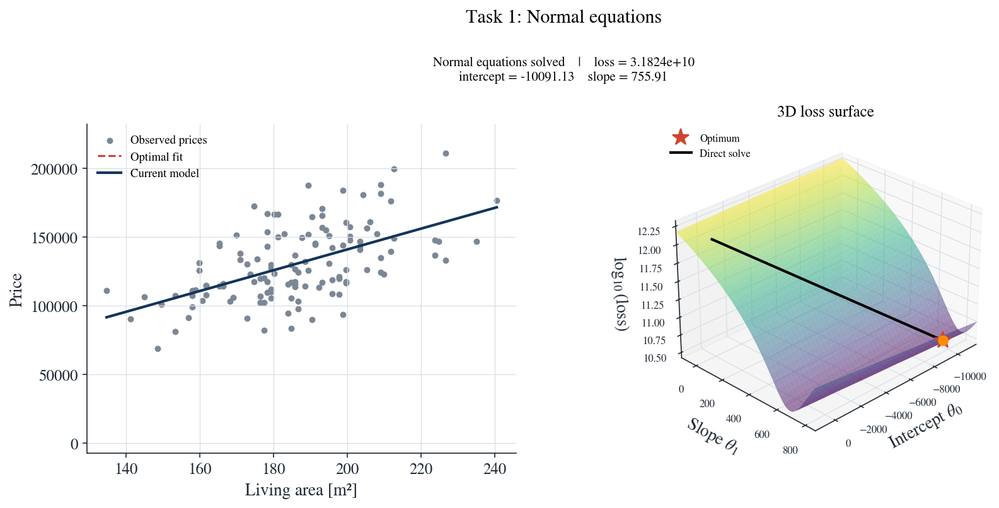
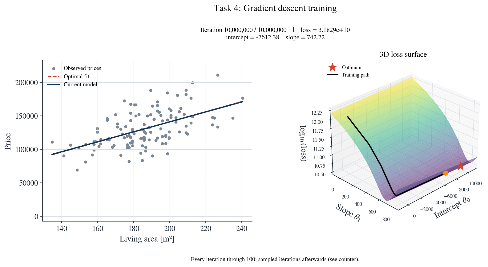

# Lab 1: Linear Regression of House Prices

This repository contains Python implementations of a house-price linear-regression assignment for TNK129 Machine Learning for Smart Cities.

## Project preview

<p align="center">
  
  
</p>

<p align="center">
  
  
</p>

- The [`assignment_1/`](assignment_1/) folder contains four independent task scripts, their setup instructions, and generated figures and training animations.
- [`linear_regression_house_prices.py`](linear_regression_house_prices.py) and [`linear_regression_house_prices.ipynb`](linear_regression_house_properties.ipynb) contain a combined implementation.
- The house-price data is included at the repository root and in `assignment_1/`, so both implementations can run from their own folder.

## Setup

Install the dependencies:

```bash
python3 -m pip install -r assignment_1/requirements.txt
```

## Run the combined implementation

From the repository root, run:

```bash
python3 linear_regression_house_prices.py
```

Or open `linear_regression_house_prices.ipynb` in Jupyter and run its cells.

## Run the assignment tasks

Change into the assignment folder and run any task directly:

```bash
cd assignment_1
python3 task_1.py
```

| File | Purpose |
| --- | --- |
| `task_1.py` | Solve the normal equations for the optimal intercept and slope. |
| `task_2.py` | Run batch gradient descent for 10 million iterations. |
| `task_3.py` | Explore the loss surface and gradient-descent path. |
| `task_4.py` | Analyze convergence, curvature, and parameter error. |

Run one task at a time. Tasks 2–4 open plots; close the plot windows to let each program finish. Task 1 saves plots without opening a window by default. Use `python3 task_1.py --show` to open its plot window too.

Each task loads `HousePrices.csv` from its own folder and can also be run from another working directory. See [`assignment_1/README.md`](assignment_1/README.md) for additional task and VS Code instructions.

## Model and data

The input is `SqFt`, converted to square metres, and the target is `Price`. The model is:

```text
price = intercept + slope * area
```

The objective is half the sum of squared errors, without dividing by the number of houses. Gradient descent starts at zero, uses a learning rate of `1e-7`, and runs for `10,000,000` iterations.

## Training animations and figures

The task scripts save plots and training animations under `assignment_1/figures/`. Each task's GIF shows the fitted line and rotating 3D loss surface. Tasks 2–4 animate recorded training iterations; task 1 shows the zero model and the direct normal-equation solution. The 3D axes represent intercept, slope, and `log10(loss)`. Matplotlib is used; Manim is not required.

## Repository

[Lab-1-Linear-regression_Python](https://github.com/nomantabassum38/Lab-1-Linear-regression_Python)
