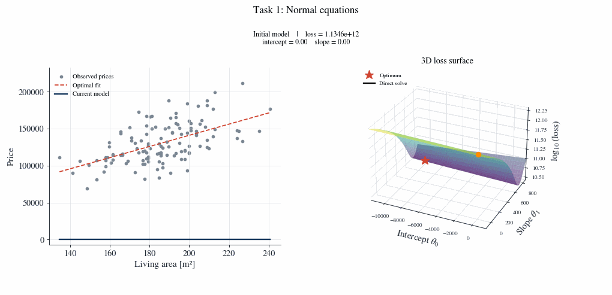
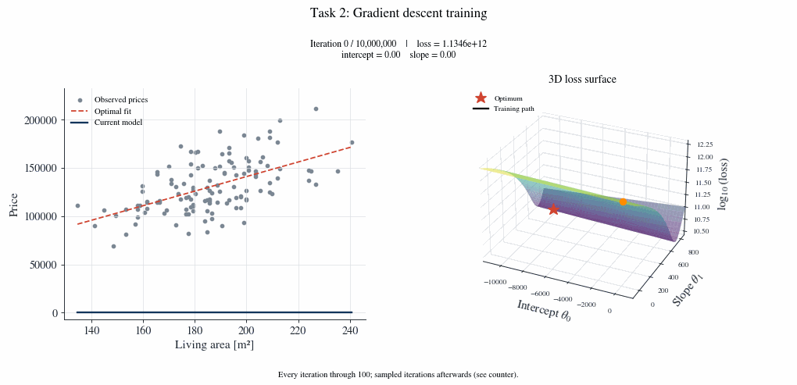

# Assignment 1 — Linear regression of house prices

Four independent Python programs for TNK129 Machine Learning for Smart Cities.
Each program loads `HousePrices.csv` beside its file and computes all of its own
prerequisites. Run any task directly; there is no requirement to run another task first.
The original combined script and notebook are also included at the repository root.

## Setup

Open this folder in VS Code and select a Python interpreter with the dependencies installed:

```bash
python3 -m pip install -r requirements.txt
```

## Tasks

| File | Purpose | Output |
| --- | --- | --- |
| `task_1.py` | Solve normal equations for the optimal intercept and slope | Fitted line and minimum loss |
| `task_2.py` | Run full batch gradient descent for 10 million iterations | Parameters, loss and comparison with the optimal fit |
| `task_3.py` | Explore the loss surface and gradient descent path | 3D loss surface with recorded iterations |
| `task_4.py` | Analyze convergence, curvature and parameter error | Summary, contour plot and convergence plots |

```bash
python3 task_1.py
python3 task_2.py
python3 task_3.py
python3 task_4.py
```

Task 1 saves plots without opening a window by default, avoiding GUI backend errors.
Use `python3 task_1.py --show` to also open its plot window.
Run one command at a time. For tasks 2–4, close the plot windows to let each program finish.
You can also open a task in VS Code and click **Run Python File**.
For task 1, run **Terminal: Run Task** and select **Run task 1**. This launches the
script as a process argument, avoiding terminal filename quoting problems. In a
terminal already open in this folder, you can also run `python3 task_1.py`.
Press **F5** and select **Run task 1** to use the debugger. These options work with
either `ML Assignments` or `assignment_1` open as the workspace folder.
Plots are saved as PNG and PDF in `figures/task_1/` through `figures/task_4/`.
Data paths are resolved from each script, so commands also work from another directory.

## Model and data

The input is `SqFt`, converted to square metres; the target is `Price`.
The model is `price = intercept + slope * area`.
The objective is half the **sum** of squared errors, with no division by the number of houses.
Gradient descent starts at zero, uses a learning rate of `1e-7`, and performs
`10_000_000` iterations. Tasks 2–4 repeat the required calculations independently.
Code comments explain data preparation, fitting, optimization and plotting.

GitHub repository: https://github.com/nomantabassum38/Lab-1-Linear-regression_Python

## Training animations

Each task also saves `taskN_training.gif` in its own `figures/task_N/` folder.
Open the GIF in a browser or image viewer to watch the fitted line and rotating 3D loss surface,
with the current iteration, intercept and slope displayed in each frame.
Tasks 2–4 show every iteration from 0 through 100, then up to 60 sampled recorded
iterations through 10,000,000. Later frames skip iterations to keep playback and
file size manageable. All displayed parameters come from the actual training run.
Task 1 has no iterative training: its rotating animation holds the zero model,
then the direct normal-equation solution, without inventing intermediate updates. GIFs are saved automatically before plot windows open.
GIF encoding runs in a local temporary folder before copying the completed file
into the output folder. If OneDrive or another storage provider times out, the
script prints the local GIF path and continues; open or copy that file from the
printed location.

The 3D axes are intercept, slope and log10(loss); the logarithmic height makes the
narrow valley visible. The moving orange marker and black trail show actual
recorded parameters. Each task also saves `taskN_training_3d.png` as a static
3D overview. The adjacent area/price plot stays two-dimensional because the
model has one input feature. These animations use Matplotlib, so Manim is not
required. Existing diagnostic plots remain available alongside the 3D outputs.

## Animation previews

### Task 1



### Task 2



### Task 3


### Task 4


